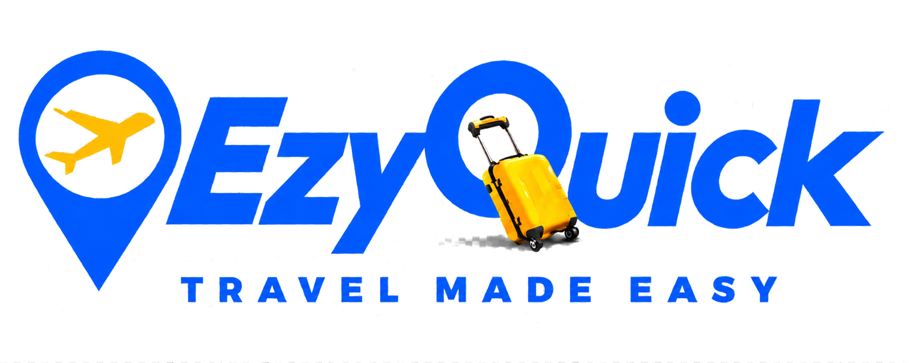

# EzyQuick — Brand, Logo & Existing Website Audit

**Audit Date:** November 24, 2026  
**Source Audited:** Live production site `https://ezyquick.in/` (`index.php`, `leisure-travel.php`, `corporate-travel.php`, `medical-travel.php`, `visa-services.php`, `air-tickets.php`, `hotel-bookings.php`, `contact.php`, `/assets/css/style.css?v=20261123slider`)  
**Workspace Baseline:** `/home/antigravity/samikshverma590-ops/EzyQuick-2` — fresh empty Git repository (`main` branch, no commits, no prior framework or dependencies).

---

## 1. Official Logo Investigation (Mandatory Evidence)

- **Original Logo Source URL:** `https://ezyquick.in/assets/EzyQuick_Logo_Transparent_Sticker.png`
- **Archived Unmodified Local Copies:**
  - Research archive: `docs/research/assets/EzyQuick_Logo_Transparent_Sticker.png`
  - Production public asset: `public/brand/ezyquick-logo.png`
- **Format & Dimensions:** PNG (RGBA, transparent background), `1600 × 640 px`, exact aspect ratio `2.5 : 1` (`463 KB`).
- **Visual Lockup Anatomy:**
  1. **Left Icon:** Location pin in vivid Electric Cobalt Blue (`#0059FD`) with a circular white knockout containing an upward-banking Solar Gold airplane (`#FDBC03`).
  2. **Wordmark:** Bold italic geometric sans-serif **`EzyQuick`** in `#0059FD`.
  3. **Custom Q Motif:** A glossy yellow/gold rolling hard-shell cabin suitcase (`#FDBC03`–`#FEDD03`, black handle/wheels `#060605`, soft drop shadow) angled across the lower-right counter of the `Q`.
  4. **Tagline:** Wide-tracked uppercase geometric sans-serif **`TRAVEL MADE EASY`** beneath the wordmark in `#0059FD`.



---

## 2. Pixel-Level Opaque Color Extraction

Sampled exclusively from **199,626 flat interior opaque pixels** (`alpha == 255`, all four 4-connected neighbors opaque with local channel variance ≤ 10) to eliminate all transparent background pixels and anti-aliasing edge artifacts.

| Role | Name | Extracted HEX | RGB | Share of Flat Opaque Pixels | Evidence & Source Element | Confidence |
|---|---|---|---|---|---|---|
| **Primary Brand Color** | **EzyQuick Cobalt** | `#0059FD` | `rgb(0, 89, 253)` | `81.59%` (+ `8.11%` `#0359F9`) | Solid fill of location pin, **`EzyQuick`** wordmark, and **`TRAVEL MADE EASY`** tagline | **High (Verified)** |
| **Secondary Brand Color** | **Solar Departure Gold** | `#FDBC03` | `rgb(253, 188, 3)` | `3.06%` primary flat (`~8.9%` across gold shading `#FDA102`–`#FEDD03`) | Flat airplane icon inside pin + primary mid-tone body of cabin suitcase | **High (Verified)** |
| **Gold Highlight** | **Sunlit Gold** | `#FED103` | `rgb(254, 209, 3)` | `1.53%` | Upper highlight plane on cabin suitcase | **High (Verified)** |
| **Gold Shadow** | **Deep Amber** | `#FDA102` | `rgb(253, 161, 2)` | `0.39%` | Lower shaded crease of cabin suitcase | **High (Verified)** |
| **Logo Dark Neutral** | **Obsidian Trim** | `#060605` | `rgb(6, 6, 5)` | `0.20%` | Suitcase handle trim, zipper seam, and spinner wheels | **High (Verified)** |

---

## 3. Existing Live Website CSS & Inconsistencies

Inspected directly from `https://ezyquick.in/assets/css/style.css?v=20261123slider`:

```css
:root {
  --blue: #55b8ec;
  --navy: #102b46;
  --yellow: #f4c84b;
  --ink: #17212b;
  --muted: #6c747c;
  --paper: #f8f7f3;
  --white: #fff;
  --line: #e6e3dc;
  --serif: 'Playfair Display', Georgia, serif;
  --sans: 'DM Sans', Arial, sans-serif;
}
```

### Identified Brand & Technical Inconsistencies on the Existing Site
1. **Palette Drift vs. Official Logo:** The existing stylesheet uses sky blue `#55b8ec`, arbitrary `#168FE5` (forced with `!important` in the footer), and muted `#f4c84b`, none of which derive cleanly from the actual official logo's `#0059FD` Cobalt and `#FDBC03` Solar Gold.
2. **Broken HTML Tag in Header:** The `` bracket.
3. **Missing Dedicated Service Routes:** Forex Services, Travel Insurance, and MICE Services have no dedicated pages and fall back to `contact.php`.
4. **No Individual Destination Pages:** All 14 advertised destinations link back to `leisure-travel.php` or `#enquiry` rather than dedicated destination story pages.
5. **Anti-Bot Gate on Root URL:** Direct requests to `/` occasionally hit Hostinger's browser-check interstitial while `/index.php` and `/leisure-travel.php` serve directly.
6. **External Hotlinked Images:** Live site hotlinks third-party images (including `auth.flightkitten.com` for Abu Dhabi), creating reliability risk.

---

## 4. Brand Preservation Rules (Mandatory Across All Pages)

1. **Zero Logo Alteration:** Always render `/brand/ezyquick-logo.png` unmodified. Never recolor, invert, stretch, crop, redraw, or apply CSS `filter` to the official logo.
2. **Light-Surface Protection:** Because the official logo uses `#0059FD` blue lettering and `#060605` suitcase wheels with a soft light-surface drop shadow, it **must always sit on a crisp white/alabaster surface (`#FFFFFF` or `#F7F6F2`)**. When placed inside a dark hero navigation bar before scroll or inside a dark footer band, enclose the lockup in a crisp white architectural plate (`background: #FFFFFF`, generous clear space) so the original logo remains 100% legible and uncorrupted.
3. **Clear Space & Minimum Size:** Maintain minimum clear space equal to the height of the tagline (`TRAVEL MADE EASY`) around all four sides. Minimum rendered width: `132px` on mobile, `164px`–`196px` on desktop, preserving exact `2.5:1` aspect ratio.
4. **Controlled Vibrant Accent Discipline:** Never flood large backgrounds with `#0059FD` or `#FDBC03`. Anchor the site in refined architectural neutrals (deep maritime midnight `#091526`, warm mineral alabaster `#F7F6F2`, crisp gallery white `#FFFFFF`, slate ink `#141E2B`) and reserve `#0059FD` / `#0044C4` and `#FDBC03` for surgical editorial moments: primary CTAs, active route telemetry, SVG journey line, hover fills, and focus rings.

---

## 5. Verified Factual Business Inventory (Source of Truth)

- **Legal Entity:** EzyQuick Travel Solutions (`© 2026 EzyQuick Travel Solutions`)
- **Official Taglines:** `EzyQuick — Travel Made Easy` | `Travel Beyond the Ordinary`
- **India Office:** HN 3234, Shop Office No. 2, Ground Floor, Ranjit Nagar, Delhi - 110008, India · Phone: `+91 8527729449`
- **Dubai Office:** IFZA Properties, Silicon Oasis, UAE · Phone: `+971 589658819`
- **Official Email:** `info@ezyquick.in`
- **Official WhatsApp:** `+91 8527729449` (`https://wa.me/918527729449?text=Hello%20EzyQuick%2C%20I%20would%20like%20to%20plan%20a%20journey.`)
- **Advertised Services (9):** Corporate Travel, Medical Travel, Leisure Travel, Visa Services (includes enquiry reference to the proposed "Free Dubai Visa for a Kid" family promotion subject to eligibility terms), Air Tickets, Hotel Bookings, Forex Services, Travel Insurance, MICE Services.
- **Advertised Destinations (14):**
  - *India (4):* Kerala, Goa, Andaman & Nicobar, Ladakh
  - *International (10):* Dubai, Abu Dhabi, Phuket, Krabi, Phu Quoc (Vietnam), Bali, Sri Lanka, Singapore, Malaysia, Almaty (Kazakhstan)
- **Strict Honesty Policy:** Zero invented reviews, zero fake star ratings, zero fabricated partner logos, zero live prices or guaranteed visa/medical outcomes.
